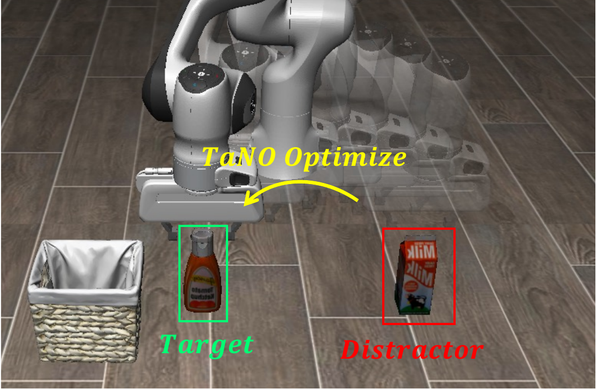

# Act on What You See: Target-directed Noise Optimization for Frozen Flow-Matching Policies

**Sunghun Kim, Junho Kim, Geo Ahn, Jinwoo Choi**
Kyung Hee University

Under review at KSC 2026 (Korea Software Congress)

<p align="center">
  
</p>

**TaNO** (**Ta**rget-directed **N**oise **O**ptimization) is a zero-training,
test-time steering method for flow-matching VLA policies such as $\pi_{0.5}$.
When the test-time instruction or object layout deviates from the training
distribution (e.g., target objects are swapped), a frozen policy fails in a
characteristically *directional* way: reaching and grasping stay intact, but
the robot heads to where the target used to be during training. TaNO repairs
these failures by optimizing **only the initial noise** of the flow-matching
sampler: at every replanning step it backpropagates through a differentiable
Euler unrolling of the flow ODE and minimizes a cosine loss between the
predicted chunk's planar displacement and the direction toward the goal
object. The model weights and inputs are untouched; only the horizontal (xy)
action dimensions are steered; steering is released before manipulation.

<p align="center">
  
</p>

## Results

Swap benchmarks built on LIBERO (1,000 episodes per condition, paired seeds):

| Method | Instruction swap | Position swap |
|---|---|---|
| Baseline (frozen $\pi_{0.5}$) | 28.6 | 10.6 |
| **TaNO (ours)** | **66.0** | **55.0** |

LIBERO-Plus robustness suite by perturbation axis (success rate, %):

| Method | Language | Layout | Robot-Init |
|---|---|---|---|
| Baseline | 89 | **98** | 85 |
| **TaNO (ours)** | **99** | 95 | **92** |

> The goal coordinate is read from the simulator (an *oracle* goal signal), so
> these numbers are an upper bound on what noise-space steering can recover
> when the goal direction is known — see the paper's discussion. The method
> needs only a coarse planar direction, not a precise pose.

## Repository layout

```
tano/
  rollout_swap.py    swap-benchmark rollouts (baseline / TaNO / extra baselines)
  pi05_adapter.py    lerobot pi0.5 loading + processor pipeline
  libero_utils.py    LIBERO env helpers
  metrics.py         episode success metrics (asked-in-basket, lifts, reach)
  paired_stats.py    paired analysis: Wilson CI, McNemar, clustered bootstrap
lplus/
  setup_liberoplus.py  one-time LIBERO-Plus drop-in setup (symlinks only)
  lplus_roll.py        LIBERO-Plus rollouts (language/layout/camera/robotinit)
  selection.json(2)    evaluated task instances
scripts/
  run_swap.sh        multi-GPU swap rollout runner
```

## Installation

```bash
conda create -n tano python=3.10 -y && conda activate tano
pip install -r requirements.txt
# lerobot with pi0.5 + LIBERO simulation support:
pip install "lerobot[libero]"
```

The policy checkpoint `lerobot/pi05_libero_finetuned` is downloaded from the
HuggingFace Hub on first use. Rendering uses MuJoCo EGL (headless).

## Usage

**Instruction swap** (paper setting: fixed-horizon release, 10 replans = 50 steps):

```bash
OUT=out/swaproll CONDS="none noiseopt" NGPU=4 \
  EXTRA="--release_replans 10" bash scripts/run_swap.sh
```

**Position swap**:

```bash
OUT=out/posswaproll CONDS="none noiseopt" NGPU=4 \
  EXTRA="--posswap --release_replans 10" bash scripts/run_swap.sh
```

**Paired statistics** (Wilson CIs, McNemar, scene-clustered bootstrap):

```bash
python -m tano.paired_stats --root out/swaproll \
  --key asked_in_basket --none-tag none --steer-tag noiseopt10x0.5-r10
python -m tano.paired_stats --root out/posswaproll \
  --key env_success --none-tag posnone --steer-tag posnoiseopt10x0.5-r10
```

**LIBERO-Plus** (proximity release; uses the env's own success signal).
Requires a [LIBERO-plus](https://github.com/sylvestf/LIBERO-plus) checkout
with its released assets unpacked:

```bash
python lplus/setup_liberoplus.py --root /path/to/LIBERO-plus   # once
python lplus/lplus_roll.py --axis language --cond none     --eps 10 --out out/lplus
python lplus/lplus_roll.py --axis language --cond noiseopt --eps 10 --out out/lplus
```

Rollouts are resumable: episodes with an existing `meta.json` are skipped, so
killed jobs can simply be relaunched. Noise seeds are a deterministic function
of the episode index, which makes all comparisons paired.

`rollout_swap.py` also ships two additional baselines not reported in the
paper: `--cond guide` (per-step flow guidance on the closed-form terminal
estimate) and `--cond bon` (best-of-N sampling), plus `--gt_noise` for the
goal-perturbation robustness ablation.

## Citation

```bibtex
@inproceedings{kim2026tano,
  title     = {Act on What You See: Target-directed Noise Optimization for
               Frozen Flow-Matching Policies},
  author    = {Kim, Sunghun and Kim, Junho and Ahn, Geo and Choi, Jinwoo},
  booktitle = {Korea Software Congress (KSC)},
  year      = {2026}
}
```

## License

MIT License (see [LICENSE](LICENSE)). Portions are adapted from
[action-atlas](https://github.com/CWRU-AISM/action-atlas) and
[lerobot](https://github.com/huggingface/lerobot), both Apache License 2.0 —
see [NOTICE](NOTICE). Benchmarks build on
[LIBERO](https://github.com/Lifelong-Robot-Learning/LIBERO) and
[LIBERO-plus](https://github.com/sylvestf/LIBERO-plus).
