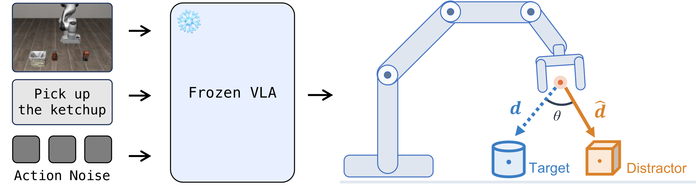

# PilotVLA: Test-Time Steering of VLAs via Initial-Noise Optimization
### KSC 2026

 [](https://vll.khu.ac.kr/) [](LICENSE)

**Junpyo Hong**, Sunghun Kim, Junho Kim, Geo Ahn, Jinwoo Choi<sup>*</sup>

Kyung Hee University &nbsp;·&nbsp; <sup>*</sup>Corresponding author

---

<p align="center">
  
</p>

*Out-of-distribution task perturbation: this scene was only ever trained to pick up the salad dressing, but the instruction now asks for the tomato sauce. Both panels start from the same initial state and noise seed. Without steering, π0.5 picks up the salad dressing it was trained on; PilotVLA steers it toward the tomato sauce for the first 10 replans and then hands control back to the unmodified policy, which grasps and places on its own (playback 1.5×).*


## ✨ Highlights

- 🎯 Identifies a **position-memorization** failure of frozen flow-matching VLAs: under task and position perturbations the policy heads to the object location seen in training, while its manipulation skills stay intact.
- 🧭 Proposes **PilotVLA** (**P**olicy steering by **I**nitial-noise **L**atent **O**ptimization at **T**est time), which optimizes **only the initial noise** of the flow sampler through a differentiable Euler unrolling, with a direction-only cosine loss and early release.
- 🔒 **Training-free**: no weight updates, no input changes, no demonstrations. The target direction enters only as a constant of the loss, so PilotVLA attaches to a deployed policy as-is.
- 📈 Improves π0.5 from **28.6% → 66.0%** under task perturbation and **10.6% → 55.0%** under position perturbation, and transfers unchanged to **MolmoAct2** and **SmolVLA**.

<p align="center">
  
</p>

---

## 🛠️ Installation

```bash
conda create -n pilotvla python=3.10 -y
conda activate pilotvla

git clone https://github.com/intpboy/PilotVLA.git && cd PilotVLA
pip install -r requirements.txt
pip install "lerobot[libero]"   # pi0.5 policy + LIBERO simulation
```

The policy checkpoint `lerobot/pi05_libero_finetuned` is downloaded from the HuggingFace Hub on first use. Rendering uses MuJoCo EGL (headless).

---

## 📁 Project Structure

```bash
PilotVLA/
│── src/            # steering sampler (steering.py), pi0.5 adapter, LIBERO env helpers, metrics
│── tools/          # command-line entry points (rollouts, LIBERO-Plus setup, paired statistics)
│── scripts/        # one pipeline script per benchmark
│── annotations/    # evaluated LIBERO-Plus task instances
│── assets/         # README figures
│── requirements.txt
│── README.md
```

---

## 📂 Benchmarks

We used the following benchmarks in our experiments:

- **Task perturbation** and **position perturbation**, built on [LIBERO](https://github.com/Lifelong-Robot-Learning/LIBERO)-Object (10 scenes × 5 in-scene distractors × 20 episodes = 1,000 episodes each). Task perturbation rewrites the instruction to ask for a distractor; position perturbation swaps the target and a distractor at initialization. Both are generated on the fly by `tools/rollout_libero.py`, so no extra data is needed.
- [LIBERO-Plus](https://github.com/sylvestf/LIBERO-plus): language, layout and robot-initial-pose axes. Requires a LIBERO-plus checkout with its released assets unpacked; the evaluated task instances are in `annotations/liberoplus/`.

---

## 🚀 Running PilotVLA

```bash
NGPU=4 bash scripts/task_perturbation.sh rollout       # baseline + PilotVLA
NGPU=4 bash scripts/position_perturbation.sh rollout

LIBERO_PLUS_ROOT=/path/to/LIBERO-plus bash scripts/liberoplus.sh setup   # once
NGPU=4 bash scripts/liberoplus.sh rollout
```

Each script runs the frozen baseline and PilotVLA with the paper settings (10 Adam steps, lr 0.5, K = 30; fixed-horizon release after 10 replans on task/position perturbation, proximity release on LIBERO-Plus). Noise seeds are a deterministic function of the episode index, so both conditions share initial states and noise. Rollouts are resumable: episodes with an existing `meta.json` are skipped, so killed jobs can simply be relaunched.

A single condition can also be run directly:

```bash
python tools/rollout_libero.py --out out/task_perturbation --cond noiseopt \
    --opt_steps 10 --opt_lr 0.5 --K 30 --release_replans 10
```

`tools/rollout_libero.py` also ships two baselines not reported in the paper, `--cond guide` (per-step flow guidance on the closed-form terminal estimate) and `--cond bon` (best-of-N sampling), plus `--gt_noise` for a target-noise robustness ablation.

---

## 📊 Evaluation

```bash
bash scripts/task_perturbation.sh stats       # Wilson CIs, paired McNemar test,
bash scripts/position_perturbation.sh stats   # scene-clustered bootstrap
bash scripts/liberoplus.sh stats
```

Success rate (%), paired seeds. Task and position perturbation use 1,000 episodes per model; LIBERO-Plus uses 480, 340 and 300 episodes for the language, layout and robot-initial-pose axes.

| Model | Method | Task pert. | Position pert. | Lang. | Layout | R-Init |
|---|---|---|---|---|---|---|
| π0.5 | Baseline | 28.6 | 10.6 | 89.2 | **98.2** | 85.0 |
| | **PilotVLA** | **66.0** | **55.0** | **98.8** | 95.0 | **91.7** |
| MolmoAct2 | Baseline | 35.3 | 28.1 | 90.8 | **99.4** | 75.7 |
| | **PilotVLA** | **76.5** | **63.2** | **94.0** | 95.6 | **86.0** |
| SmolVLA | Baseline | 0.5 | 0.6 | 16.2 | 47.1 | 31.0 |
| | **PilotVLA** | **16.0** | **6.8** | **30.8** | **50.0** | **47.7** |

This release contains the π0.5 code; MolmoAct2 and SmolVLA were run with the same steering, unchanged except that MolmoAct2 uses its full chunk (K = 10). Over a typical 30-replan episode on π0.5, steering costs 236 vs. 151 TFLOPs (1.6×): the VLM backbone still runs once per replan, and gradients flow only through the action expert.

> The target coordinate is read from the simulator (an *oracle* signal), so these numbers show what noise-space steering can recover when the target direction is known.

---

## 📎 Citation

```bibtex
@inproceedings{hong2026pilotvla,
  title={PilotVLA: Test-Time Steering of VLAs via Initial-Noise Optimization},
  author={Hong, Junpyo and Kim, Sunghun and Kim, Junho and Ahn, Geo and Choi, Jinwoo},
  booktitle={Korea Software Congress (KSC)},
  year={2026}
}
```

---

## 📜 License

This project is licensed under the [MIT License](LICENSE). Portions are adapted from action-atlas and lerobot (Apache License 2.0); see [NOTICE](NOTICE).

---

## 🙏 Acknowledgements

This work builds upon:
[lerobot](https://github.com/huggingface/lerobot),
[openpi](https://github.com/Physical-Intelligence/openpi),
[action-atlas](https://github.com/CWRU-AISM/action-atlas),
[LIBERO](https://github.com/Lifelong-Robot-Learning/LIBERO),
[LIBERO-plus](https://github.com/sylvestf/LIBERO-plus)
