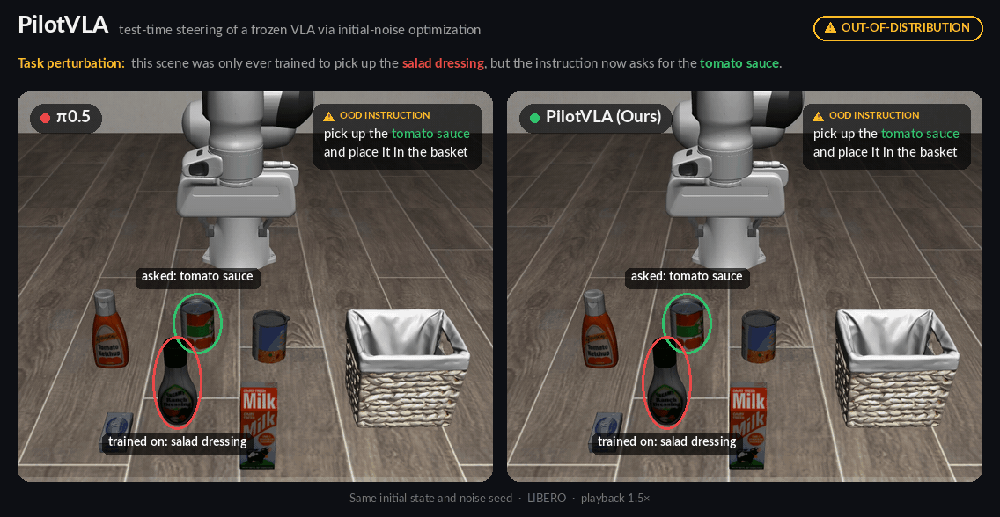

# PilotVLA: Test-Time Steering of VLAs via Initial-Noise Optimization

**Junpyo Hong, Sunghun Kim, Junho Kim, Geo Ahn, Jinwoo Choi**
Kyung Hee University

KSC 2026 (Korea Software Congress)

<p align="center">
  
</p>

**PilotVLA** (**P**olicy steering by **I**nitial-noise **L**atent **O**ptimization at **T**est time) is a training-free
test-time steering method for flow-matching VLA policies such as $\pi_{0.5}$.
When the test-time instruction or object layout deviates from the training
distribution (e.g., the requested object or the object positions change), a
frozen policy fails in a characteristically *directional* way: reaching and
grasping stay intact, but the robot heads to the object location seen during
training. PilotVLA repairs these failures by optimizing **only the initial
noise** of the flow-matching sampler: at every replanning step it
backpropagates through a differentiable Euler unrolling of the flow ODE and
minimizes a cosine loss between the displacement of the predicted action chunk
and the direction toward the target object. The model weights and inputs are
untouched, and steering is released early so that the frozen policy completes
the task.

<p align="center">
  
</p>

## Demo

<p align="center">
  
</p>

Task perturbation: the instruction asks for the tomato sauce, but the scene comes
from a task that was trained on the salad dressing. Both panels start from the
same initial state and noise seed. Without steering, $\pi_{0.5}$ picks up the
salad dressing it was trained on; PilotVLA steers it toward the tomato sauce for
the first 10 replans and then releases control to the unmodified policy, which
grasps and places on its own (playback 2×).

## Results

Success rate (%) on the LIBERO-based task- and position-perturbation
benchmarks (1,000 episodes per model, paired seeds) and on three
LIBERO-Plus axes (language 480, layout 340, robot initial pose 300 episodes):

| Model | Method | Task pert. | Position pert. | Lang. | Layout | R-Init |
|---|---|---|---|---|---|---|
| $\pi_{0.5}$ | Baseline | 28.6 | 10.6 | 89.2 | **98.2** | 85.0 |
| | **PilotVLA** | **66.0** | **55.0** | **98.8** | 95.0 | **91.7** |
| MolmoAct2 | Baseline | 35.3 | 28.1 | 90.8 | **99.4** | 75.7 |
| | **PilotVLA** | **76.5** | **63.2** | **94.0** | 95.6 | **86.0** |
| SmolVLA | Baseline | 0.5 | 0.6 | 16.2 | 47.1 | 31.0 |
| | **PilotVLA** | **16.0** | **6.8** | **30.8** | **50.0** | **47.7** |

This release contains the $\pi_{0.5}$ code; MolmoAct2 and SmolVLA were run
with the same steering, unchanged except that MolmoAct2 uses its full chunk
($K = 10$ instead of $K = 30$). Over a typical 30-replan episode on
$\pi_{0.5}$, steering costs 236 vs. 151 TFLOPs (1.6×): the VLM backbone still
runs once per replan, and gradients flow only through the action expert.

> The target coordinate is read from the simulator (an *oracle* signal), so
> these numbers show what noise-space steering can recover when the target
> direction is known. The method needs only a coarse direction, not a
> precise pose.

## Repository layout

```
pilotvla/
  rollout_swap.py    task/position-perturbation rollouts (baseline / PilotVLA / extra baselines)
  pi05_adapter.py    lerobot pi0.5 loading + processor pipeline
  libero_utils.py    LIBERO env helpers
  metrics.py         episode success metrics (asked-in-basket, lifts, reach)
  paired_stats.py    paired analysis: Wilson CI, McNemar, clustered bootstrap
lplus/
  setup_liberoplus.py  one-time LIBERO-Plus drop-in setup (symlinks only)
  lplus_roll.py        LIBERO-Plus rollouts (language/layout/camera/robotinit)
  selection.json(2)    evaluated task instances
scripts/
  run_swap.sh        multi-GPU swap rollout runner
```

## Installation

```bash
conda create -n pilotvla python=3.10 -y && conda activate pilotvla
pip install -r requirements.txt
# lerobot with pi0.5 + LIBERO simulation support:
pip install "lerobot[libero]"
```

The policy checkpoint `lerobot/pi05_libero_finetuned` is downloaded from the
HuggingFace Hub on first use. Rendering uses MuJoCo EGL (headless).

## Usage

The code calls the two perturbation benchmarks *swap* (`swaproll`, `--posswap`).

**Task perturbation** (paper setting: fixed-horizon release, 10 replans = 50 steps):

```bash
OUT=out/swaproll CONDS="none noiseopt" NGPU=4 \
  EXTRA="--release_replans 10" bash scripts/run_swap.sh
```

**Position perturbation**:

```bash
OUT=out/posswaproll CONDS="none noiseopt" NGPU=4 \
  EXTRA="--posswap --release_replans 10" bash scripts/run_swap.sh
```

**Paired statistics** (Wilson CIs, McNemar, scene-clustered bootstrap):

```bash
python -m pilotvla.paired_stats --root out/swaproll \
  --key asked_in_basket --none-tag none --steer-tag noiseopt10x0.5-r10
python -m pilotvla.paired_stats --root out/posswaproll \
  --key env_success --none-tag posnone --steer-tag posnoiseopt10x0.5-r10
```

**LIBERO-Plus** (proximity release; uses the env's own success signal).
Requires a [LIBERO-plus](https://github.com/sylvestf/LIBERO-plus) checkout
with its released assets unpacked:

```bash
python lplus/setup_liberoplus.py --root /path/to/LIBERO-plus   # once
python lplus/lplus_roll.py --axis language --cond none     --eps 10 --out out/lplus
python lplus/lplus_roll.py --axis language --cond noiseopt --eps 10 --out out/lplus
```

Rollouts are resumable: episodes with an existing `meta.json` are skipped, so
killed jobs can simply be relaunched. Noise seeds are a deterministic function
of the episode index, which makes all comparisons paired.

`rollout_swap.py` also ships two additional baselines not reported in the
paper: `--cond guide` (per-step flow guidance on the closed-form terminal
estimate) and `--cond bon` (best-of-N sampling), plus `--gt_noise` for the
goal-perturbation robustness ablation.

## Citation

```bibtex
@inproceedings{hong2026pilotvla,
  title     = {PilotVLA: Test-Time Steering of VLAs via Initial-Noise Optimization},
  author    = {Hong, Junpyo and Kim, Sunghun and Kim, Junho and Ahn, Geo and Choi, Jinwoo},
  booktitle = {Korea Software Congress (KSC)},
  year      = {2026}
}
```

## License

MIT License (see [LICENSE](LICENSE)). Portions are adapted from
[action-atlas](https://github.com/CWRU-AISM/action-atlas) and
[lerobot](https://github.com/huggingface/lerobot), both Apache License 2.0 —
see [NOTICE](NOTICE). Benchmarks build on
[LIBERO](https://github.com/Lifelong-Robot-Learning/LIBERO) and
[LIBERO-plus](https://github.com/sylvestf/LIBERO-plus).
